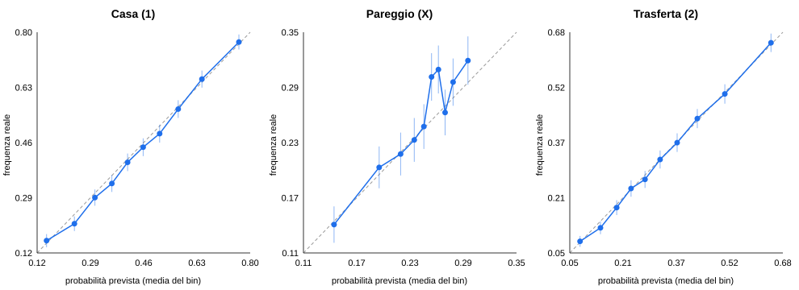

# Round 2 — esperimenti sul modello dei campionati (solo backtest)

**Nulla della produzione è stato toccato** (generate_static.py, train_stack.py, models/, docs/, workflow): tutto il codice è in `backtest/round2_*.py` e `backtest/run_round2_*.py`.

## Impostazione

- **Baseline** = modello attuale: Poisson-stack con DC sui gol (tau), DC sui tiri in porta, pi-ratings e DC sugli xG Understat con ridge = 2; due regressioni di Poisson (gol casa, gol trasferta), stimate stagione per stagione sulle sole stagioni precedenti (training dal 2016/17), test dalla stagione 2019/20 a oggi: 12751 partite con quote medie valide, 5 campionati. Con i dati aggiornati al 2026-10-12 il baseline dà log-loss 0.9831 (il file results.md, generato con meno partite, riportava 0.9834 su 12708: stessa pipeline).
- **Stesse partite per tutte le varianti**; il bootstrap è appaiato per partita (5000 ricampionamenti, stessi indici per ogni confronto, IC 95% percentile). Δ = baseline − variante (positivo = variante migliore). Il bootstrap per partita ignora la correlazione tra partite della stessa settimana: gli IC vanno letti come leggermente ottimistici (il backtest ufficiale usa blocchi per settimana).
- **Anti-leakage**: ogni feature di una partita usa solo partite con data strettamente precedente al rifit settimanale; le quote della partita da prevedere non entrano mai. Verificato con test di perturbazione e placebo (sezione finale «Controlli»).
- **Scelta degli iperparametri**: dove possibile con un criterio che non usa il periodo di test (errore di previsione del lambda implicito / del punteggio atteso Elo nelle stagioni 2016-2018). Le griglie complete sono riportate, così si vede la sensibilità. Ogni scelta è dichiarata nella sezione corrispondente.

---
## Esperimento 0 — Audit del benchmark e della calibrazione

### 0a — Benchmark di mercato con tre metodi di rimozione del margine

Le quote medie coprono tutte le 12751 partite di test (2019/20 → oggi); per le altre fonti si usa il sottoinsieme con quote valide (colonna N). Per ogni fonte il baseline è valutato sullo STESSO sottoinsieme. Δ = log-loss(normalizzazione) − log-loss(metodo): positivo = il metodo è migliore; IC 95% bootstrap appaiato per partita (5000 ricampionamenti).

| Fonte | N | Metodo | Log-loss | RPS | Brier | Δ log-loss vs norm [IC 95%] | Baseline sullo stesso insieme |
|---|---:|---|---:|---:|---:|---|---:|
| Quote medie (raccolta pre-partita) | 12751 | normalizzazione semplice | 0.9728 | 0.1963 | 0.5784 | — | 0.9831 |
| Quote medie (raccolta pre-partita) | 12751 | power | 0.9725 | 0.1962 | 0.5781 | +0.00037 [-0.00014, +0.00087] | 0.9831 |
| Quote medie (raccolta pre-partita) | 12751 | Shin | 0.9725 | 0.1962 | 0.5782 | +0.00034 [-0.00002, +0.00069] | 0.9831 |
| Quote medie di chiusura | 12751 | normalizzazione semplice | 0.9704 | 0.1956 | 0.5768 | — | 0.9831 |
| Quote medie di chiusura | 12751 | power | 0.9701 | 0.1955 | 0.5766 | +0.00035 [-0.00016, +0.00083] | 0.9831 |
| Quote medie di chiusura | 12751 | Shin | 0.9701 | 0.1955 | 0.5766 | +0.00034 [-0.00000, +0.00068] | 0.9831 |
| Pinnacle (raccolta) | 11601 | normalizzazione semplice | 0.9712 | 0.1958 | 0.5772 | — | 0.9817 |
| Pinnacle (raccolta) | 11601 | power | 0.9710 | 0.1957 | 0.5771 | +0.00019 [-0.00019, +0.00056] | 0.9817 |
| Pinnacle (raccolta) | 11601 | Shin | 0.9710 | 0.1957 | 0.5771 | +0.00018 [-0.00007, +0.00044] | 0.9817 |
| Pinnacle (chiusura) | 11604 | normalizzazione semplice | 0.9686 | 0.1951 | 0.5756 | — | 0.9817 |
| Pinnacle (chiusura) | 11604 | power | 0.9685 | 0.1950 | 0.5755 | +0.00015 [-0.00019, +0.00049] | 0.9817 |
| Pinnacle (chiusura) | 11604 | Shin | 0.9685 | 0.1951 | 0.5755 | +0.00016 [-0.00008, +0.00040] | 0.9817 |

Shin vs power sulle quote di chiusura: Δ log-loss (power − Shin) = -0.00000 [-0.00017, +0.00017].

Metodo con la log-loss più bassa per fonte, e come cambia il divario baseline − mercato (positivo = il mercato è meglio del baseline):

- Quote medie (raccolta pre-partita): norm 0.9728 → power 0.9725 (Δ +0.0004); divario +0.0103 (norm) → +0.0107 (power)
- Quote medie di chiusura: norm 0.9704 → power 0.9701 (Δ +0.0003); divario +0.0127 (norm) → +0.0130 (power)
- Pinnacle (raccolta): norm 0.9712 → power 0.9710 (Δ +0.0002); divario +0.0106 (norm) → +0.0108 (power)
- Pinnacle (chiusura): norm 0.9686 → shin 0.9685 (Δ +0.0002); divario +0.0130 (norm) → +0.0132 (shin)

### 0b — Diagramma di affidabilità del baseline (stack + xG ridge)

(Il grafico è in `backtest/results_round2_affidabilita.svg`: punti = bin per decili, barre = IC 95%, linea tratteggiata = calibrazione perfetta.)

10 bin per decili della probabilità prevista (stesso numero di partite per bin; con bin di ampiezza uguale i pareggi cadrebbero in 2-3 bin). Differenza = frequenza reale − previsione media (negativa = esito sovrastimato). SE = errore standard binomiale della frequenza.

**Casa (1)**

| Bin | N | Previsto medio | Frequenza reale | Differenza | SE |
|---:|---:|---:|---:|---:|---:|
| 1 | 1276 | 0.151 | 0.159 | +0.008 | 0.010 |
| 2 | 1275 | 0.240 | 0.211 | -0.029 | 0.011 |
| 3 | 1275 | 0.305 | 0.291 | -0.014 | 0.013 |
| 4 | 1275 | 0.359 | 0.334 | -0.024 | 0.013 |
| 5 | 1275 | 0.409 | 0.399 | -0.009 | 0.014 |
| 6 | 1275 | 0.458 | 0.445 | -0.013 | 0.014 |
| 7 | 1275 | 0.510 | 0.487 | -0.023 | 0.014 |
| 8 | 1275 | 0.569 | 0.562 | -0.007 | 0.014 |
| 9 | 1275 | 0.645 | 0.654 | +0.009 | 0.013 |
| 10 | 1275 | 0.762 | 0.768 | +0.006 | 0.012 |

Totale: previsto medio 0.4407, frequenza reale 0.4311, differenza -0.0096 (IC 95% ±0.0086). Retta di ricalibrazione logit(freq) = -0.038 + 1.035·logit(p) (1 = calibrato).

**Pareggio (X)**

| Bin | N | Previsto medio | Frequenza reale | Differenza | SE |
|---:|---:|---:|---:|---:|---:|
| 1 | 1276 | 0.147 | 0.143 | -0.004 | 0.010 |
| 2 | 1275 | 0.196 | 0.204 | +0.008 | 0.011 |
| 3 | 1275 | 0.220 | 0.218 | -0.002 | 0.012 |
| 4 | 1275 | 0.235 | 0.233 | -0.002 | 0.012 |
| 5 | 1275 | 0.245 | 0.247 | +0.002 | 0.012 |
| 6 | 1275 | 0.254 | 0.300 | +0.046 | 0.013 |
| 7 | 1275 | 0.261 | 0.307 | +0.046 | 0.013 |
| 8 | 1275 | 0.269 | 0.262 | -0.007 | 0.012 |
| 9 | 1275 | 0.277 | 0.294 | +0.017 | 0.013 |
| 10 | 1275 | 0.294 | 0.317 | +0.023 | 0.013 |

Totale: previsto medio 0.2398, frequenza reale 0.2525, differenza +0.0127 (IC 95% ±0.0075). Retta di ricalibrazione logit(freq) = +0.262 + 1.170·logit(p) (1 = calibrato).

**Trasferta (2)**

| Bin | N | Previsto medio | Frequenza reale | Differenza | SE |
|---:|---:|---:|---:|---:|---:|
| 1 | 1276 | 0.083 | 0.086 | +0.003 | 0.008 |
| 2 | 1275 | 0.144 | 0.125 | -0.019 | 0.009 |
| 3 | 1275 | 0.191 | 0.182 | -0.009 | 0.011 |
| 4 | 1275 | 0.233 | 0.236 | +0.003 | 0.012 |
| 5 | 1275 | 0.274 | 0.262 | -0.012 | 0.012 |
| 6 | 1275 | 0.319 | 0.318 | -0.000 | 0.013 |
| 7 | 1275 | 0.369 | 0.366 | -0.002 | 0.013 |
| 8 | 1275 | 0.428 | 0.435 | +0.006 | 0.014 |
| 9 | 1275 | 0.509 | 0.504 | -0.005 | 0.014 |
| 10 | 1275 | 0.644 | 0.649 | +0.005 | 0.013 |

Totale: previsto medio 0.3195, frequenza reale 0.3164, differenza -0.0031 (IC 95% ±0.0081). Retta di ricalibrazione logit(freq) = -0.000 + 1.025·logit(p) (1 = calibrato).

**Pareggio per stagione, lega e livello di gol attesi** (frequenza reale − previsto medio):

| Segmento | N | Previsto X | Reale X | Differenza |
|---|---:|---:|---:|---:|
| 2019/20 | 1725 | 0.237 | 0.243 | +0.007 |
| 2020/21 | 1826 | 0.242 | 0.255 | +0.013 |
| 2021/22 | 1825 | 0.244 | 0.259 | +0.015 |
| 2022/23 | 1826 | 0.241 | 0.243 | +0.002 |
| 2023/24 | 1752 | 0.237 | 0.264 | +0.027 |
| 2024/25 | 1752 | 0.236 | 0.249 | +0.014 |
| 2025/26 | 1752 | 0.242 | 0.255 | +0.013 |
| 2026/27 | 293 | 0.243 | 0.253 | +0.009 |
| Serie A | 2717 | 0.238 | 0.262 | +0.023 |
| Premier League | 2719 | 0.235 | 0.238 | +0.003 |
| Bundesliga | 2187 | 0.226 | 0.246 | +0.020 |
| La Liga | 2737 | 0.251 | 0.267 | +0.016 |
| Ligue 1 | 2391 | 0.246 | 0.247 | +0.001 |
| gol attesi totali bassi (terzile 1) | 4250 | 0.274 | 0.299 | +0.025 |
| gol attesi totali medi (terzile 2) | 4250 | 0.245 | 0.255 | +0.009 |
| gol attesi totali alti (terzile 3) | 4251 | 0.200 | 0.204 | +0.004 |

## Esperimento 1 — Porte chiuse e vantaggio casa per lega

### Date e flag "porte chiuse"

Ripresa post-lockdown 2019/20 rilevata sui dati (primo incontro dopo la pausa più lunga): Serie A 2020-06-20, Premier League 2020-06-17, Bundesliga 2020-05-16, La Liga 2020-06-11, Ligue 1 nessuna ripresa (ultima partita 2020-03-08). Flag = 1 dalla ripresa 2019/20 a fine 2019/20 e per tutta la stagione 2020/21 (come da definizione); non sono marcate le poche partite a porte chiuse prima del lockdown (Serie A 8-9 marzo 2020, Bundesliga 11 marzo) né le riaperture parziali di pubblico del 2020/21 (autunno 2020, primavera 2021), che non sono ricostruibili dai dati.

| Lega | Partite flag=1 | di cui 2019/20 | Vittorie casa flag=0 | Vittorie casa flag=1 | Gol casa−trasf. flag=0 | flag=1 |
|---|---:|---:|---:|---:|---:|---:|
| Serie A | 504 | 124 | 0.430 | 0.417 | +0.258 | +0.222 |
| Premier League | 472 | 92 | 0.449 | 0.396 | +0.315 | +0.081 |
| Bundesliga | 388 | 82 | 0.451 | 0.399 | +0.362 | +0.201 |
| La Liga | 490 | 110 | 0.465 | 0.414 | +0.407 | +0.220 |
| Ligue 1 | 380 | 0 | 0.447 | 0.374 | +0.342 | +0.034 |
| Tutte | 2234 | 408 | 0.449 | 0.402 | +0.336 | +0.156 |

Nel solo insieme di test (12751 partite) le partite con flag=1 sono 2234.

### Risultati (ogni variante da sola vs baseline)

| Variante | Log-loss | RPS | Brier | Δ log-loss vs baseline | IC 95% | Stagioni migliorate |
|---|---:|---:|---:|---:|---|---:|
| 1a — dummy nei DC (gol, tiri, xG) + nella regressione | 0.9828 | 0.1994 | 0.5853 | +0.00031 | [-0.00015, +0.00079] | 5/8 |
| 1a-i — dummy solo nei DC | 0.9829 | 0.1994 | 0.5853 | +0.00022 | [-0.00013, +0.00058] | 5/8 |
| 1a-ii — dummy solo nella regressione | 0.9827 | 0.1994 | 0.5853 | +0.00038 | [-0.00009, +0.00086] | 5/8 |
| 1b — vantaggio casa per lega (intercette di lega nella regressione) | 0.9835 | 0.1996 | 0.5857 | -0.00041 | [-0.00071, -0.00012] | 2/8 |
| 1a+1b — dummy completa + intercette di lega | 0.9832 | 0.1995 | 0.5856 | -0.00012 | [-0.00067, +0.00044] | 4/8 |

Nota: i DC sono già stimati campionato per campionato, quindi il vantaggio casa H è già separato per lega a livello di DC; la variante 1b agisce sulla regressione di stack (che mette insieme i 5 campionati), aggiungendo un'intercetta per lega a gol casa e gol trasferta.

**1a — dummy nei DC (gol, tiri, xG) + nella regressione**

| Metrica | Variante | Baseline | Δ (base − variante) | IC 95% |
|---|---:|---:|---:|---|
| Log-loss 1X2 | 0.9828 | 0.9831 | +0.00031 | [-0.00015, +0.00079] |
| RPS | 0.1994 | 0.1995 | +0.00010 | [-0.00004, +0.00026] |
| Brier | 0.5853 | 0.5855 | +0.00018 | [-0.00013, +0.00052] |

(Δ positivo = variante migliore; N = 12751; stagioni migliorate: 5/8)

| Stagione | 2019/20 | 2020/21 | 2021/22 | 2022/23 | 2023/24 | 2024/25 | 2025/26 | 2026/27 |
|---|---:|---:|---:|---:|---:|---:|---:|---:|
| Δ log-loss | -0.0002 | +0.0017 | +0.0003 | +0.0009 | -0.0002 | -0.0005 | +0.0001 | +0.0005 |
| N | 1725 | 1826 | 1825 | 1826 | 1752 | 1752 | 1752 | 293 |

| Lega | Serie A | Premier League | Bundesliga | La Liga | Ligue 1 |
|---|---:|---:|---:|---:|---:|
| Δ log-loss | -0.0001 | +0.0007 | +0.0005 | +0.0002 | +0.0003 |

**1a-i — dummy solo nei DC**

| Metrica | Variante | Baseline | Δ (base − variante) | IC 95% |
|---|---:|---:|---:|---|
| Log-loss 1X2 | 0.9829 | 0.9831 | +0.00022 | [-0.00013, +0.00058] |
| RPS | 0.1994 | 0.1995 | +0.00008 | [-0.00003, +0.00019] |
| Brier | 0.5853 | 0.5855 | +0.00014 | [-0.00009, +0.00039] |

(Δ positivo = variante migliore; N = 12751; stagioni migliorate: 5/8)

| Stagione | 2019/20 | 2020/21 | 2021/22 | 2022/23 | 2023/24 | 2024/25 | 2025/26 | 2026/27 |
|---|---:|---:|---:|---:|---:|---:|---:|---:|
| Δ log-loss | -0.0002 | +0.0010 | +0.0004 | +0.0004 | -0.0001 | -0.0001 | +0.0001 | +0.0004 |
| N | 1725 | 1826 | 1825 | 1826 | 1752 | 1752 | 1752 | 293 |

| Lega | Serie A | Premier League | Bundesliga | La Liga | Ligue 1 |
|---|---:|---:|---:|---:|---:|
| Δ log-loss | -0.0001 | +0.0004 | +0.0007 | +0.0003 | -0.0001 |

**1a-ii — dummy solo nella regressione**

| Metrica | Variante | Baseline | Δ (base − variante) | IC 95% |
|---|---:|---:|---:|---|
| Log-loss 1X2 | 0.9827 | 0.9831 | +0.00038 | [-0.00009, +0.00086] |
| RPS | 0.1994 | 0.1995 | +0.00011 | [-0.00004, +0.00027] |
| Brier | 0.5853 | 0.5855 | +0.00021 | [-0.00012, +0.00054] |

(Δ positivo = variante migliore; N = 12751; stagioni migliorate: 5/8)

| Stagione | 2019/20 | 2020/21 | 2021/22 | 2022/23 | 2023/24 | 2024/25 | 2025/26 | 2026/27 |
|---|---:|---:|---:|---:|---:|---:|---:|---:|
| Δ log-loss | +0.0000 | +0.0026 | +0.0002 | +0.0009 | -0.0004 | -0.0008 | +0.0001 | +0.0004 |
| N | 1725 | 1826 | 1825 | 1826 | 1752 | 1752 | 1752 | 293 |

| Lega | Serie A | Premier League | Bundesliga | La Liga | Ligue 1 |
|---|---:|---:|---:|---:|---:|
| Δ log-loss | -0.0003 | +0.0011 | -0.0002 | +0.0001 | +0.0012 |

**1b — vantaggio casa per lega (intercette di lega nella regressione)**

| Metrica | Variante | Baseline | Δ (base − variante) | IC 95% |
|---|---:|---:|---:|---|
| Log-loss 1X2 | 0.9835 | 0.9831 | -0.00041 | [-0.00071, -0.00012] |
| RPS | 0.1996 | 0.1995 | -0.00012 | [-0.00021, -0.00004] |
| Brier | 0.5857 | 0.5855 | -0.00026 | [-0.00046, -0.00006] |

(Δ positivo = variante migliore; N = 12751; stagioni migliorate: 2/8)

| Stagione | 2019/20 | 2020/21 | 2021/22 | 2022/23 | 2023/24 | 2024/25 | 2025/26 | 2026/27 |
|---|---:|---:|---:|---:|---:|---:|---:|---:|
| Δ log-loss | -0.0000 | -0.0018 | +0.0003 | -0.0003 | -0.0005 | -0.0007 | +0.0001 | -0.0002 |
| N | 1725 | 1826 | 1825 | 1826 | 1752 | 1752 | 1752 | 293 |

| Lega | Serie A | Premier League | Bundesliga | La Liga | Ligue 1 |
|---|---:|---:|---:|---:|---:|
| Δ log-loss | +0.0004 | -0.0006 | -0.0012 | -0.0001 | -0.0008 |

**1a+1b — dummy completa + intercette di lega**

| Metrica | Variante | Baseline | Δ (base − variante) | IC 95% |
|---|---:|---:|---:|---|
| Log-loss 1X2 | 0.9832 | 0.9831 | -0.00012 | [-0.00067, +0.00044] |
| RPS | 0.1995 | 0.1995 | -0.00003 | [-0.00020, +0.00015] |
| Brier | 0.5856 | 0.5855 | -0.00009 | [-0.00046, +0.00030] |

(Δ positivo = variante migliore; N = 12751; stagioni migliorate: 4/8)

| Stagione | 2019/20 | 2020/21 | 2021/22 | 2022/23 | 2023/24 | 2024/25 | 2025/26 | 2026/27 |
|---|---:|---:|---:|---:|---:|---:|---:|---:|
| Δ log-loss | -0.0003 | -0.0002 | +0.0007 | +0.0006 | -0.0006 | -0.0013 | +0.0002 | +0.0003 |
| N | 1725 | 1826 | 1825 | 1826 | 1752 | 1752 | 1752 | 293 |

| Lega | Serie A | Premier League | Bundesliga | La Liga | Ligue 1 |
|---|---:|---:|---:|---:|---:|
| Δ log-loss | +0.0003 | +0.0002 | -0.0008 | +0.0000 | -0.0005 |

### Effetto per sottoinsieme (variante 1a completa)

| Sottoinsieme | N | Δ log-loss (base − variante) | IC 95% |
|---|---:|---:|---|
| partite a porte chiuse (flag=1) | 2234 | +0.00126 | [-0.00074, +0.00328] |
| partite con pubblico (flag=0) | 10517 | +0.00010 | [-0.00028, +0.00049] |
| dalla stagione 2021/22 (H storico ancora contaminato) | 9200 | +0.00012 | [-0.00031, +0.00055] |

### Vantaggio casa stimato dal DC sui gol (media dei rifit settimanali)

H = parametro di vantaggio casa (log), delta = variazione stimata a porte chiuse; baseline = H del modello attuale, stimato su tutte le partite.

| Lega | Periodo | H con dummy (solo pubblico) | delta (porte chiuse) |
|---|---|---:|---:|
| Serie A | 2019/20-2020/21 | 0.119 | +0.113 |
| Serie A | 2021/22 | 0.120 | +0.055 |
| Serie A | 2023/24 | 0.163 | +0.096 |
| Premier League | 2019/20-2020/21 | 0.216 | -0.062 |
| Premier League | 2021/22 | 0.176 | -0.087 |
| Premier League | 2023/24 | 0.221 | -0.180 |
| Bundesliga | 2019/20-2020/21 | 0.193 | -0.100 |
| Bundesliga | 2021/22 | 0.245 | -0.061 |
| Bundesliga | 2023/24 | 0.293 | -0.088 |
| La Liga | 2019/20-2020/21 | 0.321 | -0.158 |
| La Liga | 2021/22 | 0.288 | -0.084 |
| La Liga | 2023/24 | 0.284 | -0.068 |
| Ligue 1 | 2019/20-2020/21 | 0.276 | -0.101 |
| Ligue 1 | 2021/22 | 0.224 | -0.122 |
| Ligue 1 | 2023/24 | 0.188 | -0.108 |

## Esperimento 2 — Forze implicite dalle quote passate

### Gol attesi impliciti: copertura e gestione dei dati mancanti

- Quote 1X2 di chiusura: 25534/25538 partite (2012/13 → oggi; Pinnacle in chiusura fino al 2018/19, media di mercato in chiusura dal 2019/20). Senza 1X2 (4 partite) il lambda implicito è NaN e la partita non entra nei rifit.
- Quote Over/Under 2.5: per le stagioni 2012/13-2018/19 la chiusura O/U non esiste nei file; si usa la media pre-chiusura dei bookmaker (BbAv>2.5 / BbAv<2.5), dal 2019/20 la chiusura media (AvgC>2.5 / AvgC<2.5). Partite con O/U da chiusura: 12755, da media pre-chiusura: 12782, **senza alcuna quota O/U: 1** su 25538 (di cui 1 nel periodo di test, 12751 partite).
- Gestione: dove manca l'O/U si risolve con le sole tre probabilità 1X2 (2 incognite, 2 equazioni indipendenti: sistema esattamente identificato, stesso solver). Con una sola partita interessata la scelta è irrilevante.
- Rimozione del margine: metodo power (il migliore dell'esperimento 0, a pari merito con Shin; differenze ≤ 0.0004).
- Ricostruzione: Poisson con correlazione Dixon-Coles fissa rho = -0.08 (scelta guardando solo la capacità di riprodurre le probabilità di mercato, minimo dell'errore su una griglia 0 / −0.05 / −0.08 / −0.10 / −0.13 / −0.16: nessun esito di partita coinvolto). Con Poisson indipendente (rho=0) il pareggio di mercato è sottostimato di 1.6 punti percentuali in media; con rho=−0.08 di circa 0.6.

Qualità della ricostruzione (rho=-0.08): errore medio assoluto su P(1)/P(X)/P(2): 0.0024/0.0057/0.0033; gol attesi impliciti medi 1.574 - 1.212 contro gol reali 1.545 - 1.225.

### 2a — Modello di forza DC sui lambda impliciti → feature dello stack

Come per gli xG: DC senza tau (attacco / difesa / casa), finestra 5 anni, rifit settimanale, ridge = 2, target continuo = lambda implicito della partita. Le feature `mk_lmu`, `mk_lnu` (log gol attesi del modello di forza) si aggiungono a quelle del baseline (DC gol, tiri in porta, pi-ratings, xG) nelle due regressioni di Poisson; training dello stack dal 2016/17, test dal 2019/20, come il baseline.

**Scelta del decadimento xi.** Tre criteri, mostrati per trasparenza: (i) errore di previsione del lambda implicito nelle stagioni 2016-2018 (precedenti al test; nessun esito, nessun dato di test); (ii) Δ log-loss dello stack nelle stagioni 2019/20-2021/22 (periodo di scelta); (iii) Δ log-loss nelle stagioni 2022/23 → oggi (valutazione fuori dal periodo di scelta).

| xi | MSE log-lambda 2016-18 | Δ log-loss 2019-21 | Δ log-loss 2022→ | Δ log-loss totale [IC 95%] |
|---:|---:|---:|---:|---|
| 0.002 | 0.02069 | +0.00092 | +0.00055 | +0.00071 [-0.00004, +0.00145] |
| 0.003 | 0.01926 | +0.00110 | +0.00081 | +0.00093 [+0.00010, +0.00178] |
| 0.004 | 0.01864 | +0.00132 | +0.00113 | +0.00121 [+0.00029, +0.00215] |
| 0.005 | 0.01850 | +0.00153 | +0.00141 | +0.00146 [+0.00046, +0.00248] |

Scelto xi = **0.005** con il criterio (i) (pre-test, indipendente dal periodo di valutazione); il criterio (ii) avrebbe scelto xi = 0.005.

| Variante | Log-loss | RPS | Brier | Δ log-loss vs baseline | IC 95% | Stagioni migliorate |
|---|---:|---:|---:|---:|---|---:|
| 2a — stack + forze implicite (xi=0.002) | 0.9824 | 0.1993 | 0.5850 | +0.00071 | [-0.00004, +0.00145] | 6/8 |
| 2a — stack + forze implicite (xi=0.003) | 0.9822 | 0.1993 | 0.5848 | +0.00093 | [+0.00010, +0.00178] | 6/8 |
| 2a — stack + forze implicite (xi=0.004) | 0.9819 | 0.1992 | 0.5846 | +0.00121 | [+0.00029, +0.00215] | 7/8 |
| 2a — stack + forze implicite (xi=0.005) | 0.9817 | 0.1991 | 0.5845 | +0.00146 | [+0.00046, +0.00248] | 7/8 |

**2a — stack + forze implicite (xi=0.005) — variante principale**

| Metrica | Variante | Baseline | Δ (base − variante) | IC 95% |
|---|---:|---:|---:|---|
| Log-loss 1X2 | 0.9817 | 0.9831 | +0.00146 | [+0.00046, +0.00248] |
| RPS | 0.1991 | 0.1995 | +0.00038 | [+0.00007, +0.00070] |
| Brier | 0.5845 | 0.5855 | +0.00101 | [+0.00033, +0.00170] |

(Δ positivo = variante migliore; N = 12751; stagioni migliorate: 7/8)

| Stagione | 2019/20 | 2020/21 | 2021/22 | 2022/23 | 2023/24 | 2024/25 | 2025/26 | 2026/27 |
|---|---:|---:|---:|---:|---:|---:|---:|---:|
| Δ log-loss | +0.0015 | +0.0017 | +0.0014 | +0.0005 | +0.0026 | -0.0011 | +0.0033 | +0.0036 |
| N | 1725 | 1826 | 1825 | 1826 | 1752 | 1752 | 1752 | 293 |

| Lega | Serie A | Premier League | Bundesliga | La Liga | Ligue 1 |
|---|---:|---:|---:|---:|---:|
| Δ log-loss | +0.0010 | +0.0003 | +0.0007 | +0.0031 | +0.0021 |

### 2a — sensibilità e varianti

**Decadimento oltre il range 0.002-0.005** (sensibilità: l'ottimo del range richiesto è al bordo).

| xi | MSE log-lambda 2016-18 | Δ log-loss totale | IC 95% | Stagioni migliorate |
|---:|---:|---:|---|---:|
| 0.006 | 0.01868 | +0.00168 | [+0.00060, +0.00277] | 7/8 |
| 0.008 | 0.01964 | +0.00201 | [+0.00085, +0.00317] | 7/8 |
| 0.01 | 0.02109 | +0.00219 | [+0.00099, +0.00339] | 7/8 |
| 0.015 | 0.02593 | +0.00211 | [+0.00094, +0.00329] | 6/8 |

Minimo dell'errore pre-test sull'intera griglia: xi = 0.005. Per le varianti sotto si usa xi = 0.005 (miglior valore DENTRO il range richiesto).

**Varianti** (xi fisso come sopra; ogni riga da sola vs baseline).

| Variante | Log-loss | RPS | Brier | Δ log-loss vs baseline | IC 95% | Stagioni migliorate |
|---|---:|---:|---:|---:|---|---:|
| 2a — principale (closing medio, rho=-0.08, ridge 2, xi=0.005) | 0.9817 | 0.1991 | 0.5845 | +0.00146 | [+0.00046, +0.00248] | 7/8 |
| 2a — ridge 0.5 (xi=0.005) | 0.9814 | 0.1991 | 0.5843 | +0.00169 | [+0.00060, +0.00279] | 7/8 |
| 2a — ridge 5 (xi=0.005) | 0.9820 | 0.1992 | 0.5847 | +0.00110 | [+0.00022, +0.00201] | 7/8 |
| 2a — Poisson indipendente (rho=0), xi=0.005 | 0.9817 | 0.1991 | 0.5845 | +0.00145 | [+0.00046, +0.00247] | 7/8 |
| 2a — Pinnacle in chiusura (dove disponibile), xi=0.005 | 0.9816 | 0.1991 | 0.5844 | +0.00151 | [+0.00051, +0.00253] | 7/8 |
| 2a — senza xG nello stack (sostituisce l'xG), xi=0.005 | 0.9825 | 0.1994 | 0.5850 | +0.00064 | [-0.00078, +0.00210] | 6/8 |

Nota sulla variante Pinnacle: le quote Pinnacle in chiusura mancano per metà del 2025/26 e per tutto il 2026/27; dove mancano si ricade sulla media di mercato in chiusura. La variante "senza xG" toglie xg_lmu/xg_lnu dallo stack e li sostituisce con le forze implicite: dice quanto delle informazioni xG è già contenuto nel mercato.

### 2b — Elo-Odds (Wunderlich & Memmert)

Elo per campionato in cui il "risultato" è S = P(1) + 0.5·P(X) dalle quote di chiusura senza margine (power); vantaggio casa HFA = media corrente di S nel campionato; squadra nuova = media delle 3 più deboli; feature dello stack = differenza di rating pre-partita `eo_diff` (rating casa − ospite). K scelto col criterio pre-test: errore quadratico tra punteggio atteso Elo e S nelle stagioni 2016-2018 (nessun esito, nessun dato di test).

| K | MSE(E−S) 2016-18 | Log-loss | Δ log-loss vs baseline | IC 95% | Stagioni migliorate |
|---:|---:|---:|---:|---|---:|
| 5 | 0.00841 | 0.9825 | +0.00059 | [+0.00003, +0.00116] | 7/8 |
| 10 | 0.00529 | 0.9826 | +0.00049 | [-0.00007, +0.00109] | 7/8 |
| 20 | 0.00384 | 0.9826 | +0.00048 | [-0.00015, +0.00114] | 6/8 |
| 30 | 0.00329 | 0.9825 | +0.00066 | [-0.00008, +0.00142] | 7/8 |
| 45 | 0.00286 | 0.9821 | +0.00106 | [+0.00016, +0.00198] | 6/8 |
| 60 | 0.00261 | 0.9816 | +0.00149 | [+0.00044, +0.00255] | 6/8 |
| 80 | 0.00241 | 0.9812 | +0.00198 | [+0.00080, +0.00319] | 6/8 |
| 100 | 0.00229 | 0.9808 | +0.00237 | [+0.00109, +0.00367] | 6/8 |
| 150 | 0.00214 | 0.9801 | +0.00301 | [+0.00159, +0.00444] | 6/8 |
| 200 | 0.00211 | 0.9798 | +0.00332 | [+0.00184, +0.00481] | 6/8 |
| 300 | 0.00223 | 0.9797 | +0.00340 | [+0.00191, +0.00489] | 6/8 |
| 500 | 0.00333 | 0.9809 | +0.00224 | [+0.00093, +0.00352] | 6/8 |

K scelto col criterio pre-test: **200**.

**2b — Elo-Odds K=200 — variante principale**

| Metrica | Variante | Baseline | Δ (base − variante) | IC 95% |
|---|---:|---:|---:|---|
| Log-loss 1X2 | 0.9798 | 0.9831 | +0.00332 | [+0.00184, +0.00481] |
| RPS | 0.1984 | 0.1995 | +0.00107 | [+0.00059, +0.00155] |
| Brier | 0.5831 | 0.5855 | +0.00239 | [+0.00139, +0.00341] |

(Δ positivo = variante migliore; N = 12751; stagioni migliorate: 6/8)

| Stagione | 2019/20 | 2020/21 | 2021/22 | 2022/23 | 2023/24 | 2024/25 | 2025/26 | 2026/27 |
|---|---:|---:|---:|---:|---:|---:|---:|---:|
| Δ log-loss | -0.0004 | -0.0016 | +0.0034 | +0.0030 | +0.0073 | +0.0055 | +0.0057 | +0.0065 |
| N | 1725 | 1826 | 1825 | 1826 | 1752 | 1752 | 1752 | 293 |

| Lega | Serie A | Premier League | Bundesliga | La Liga | Ligue 1 |
|---|---:|---:|---:|---:|---:|
| Δ log-loss | +0.0047 | +0.0038 | +0.0038 | +0.0017 | +0.0026 |

**Combinazione 2a + 2b nello stesso stack**

| Variante | Log-loss | RPS | Brier | Δ log-loss vs baseline | IC 95% | Stagioni migliorate |
|---|---:|---:|---:|---:|---|---:|
| 2a+2b — forze implicite (xi=0.005) + Elo-Odds (K=200) | 0.9801 | 0.1986 | 0.5833 | +0.00302 | [+0.00148, +0.00456] | 6/8 |

### Diagnostica su Elo-Odds: il guadagno compare solo dal 2021/22?

Il guadagno di 2b (K=200) è ≈0 o negativo nel 2019/20 e 2020/21 e +0.003/+0.007 dal 2021/22. Due spiegazioni possibili: (i) cambio di fonte delle quote (Pinnacle in chiusura fino al 2018/19 nel training, media di mercato dopo); (ii) lo stack con xG si allena solo dal 2016/17 (gli xG partono dal 2014 e il DC xG ha bisogno di 2 anni di storia): per il 2019/20 ha solo 3 stagioni di training per imparare il peso di una feature rumorosa come il rating Elo-Odds.

| Prova | Log-loss | Δ log-loss [IC 95%] | Δ per stagione (2019/20 → 2026/27) |
|---|---:|---|---|
| 2b K=200 con Pinnacle in chiusura ovunque (vs baseline) | 0.9798 | +0.00330 [+0.00182, +0.00479] | -0.0006, -0.0015, +0.0032, +0.0031, +0.0073, +0.0054, +0.0057, +0.0065 |
| Stack SENZA xG, training dal 2013/14: con Elo-Odds vs senza (stessa finestra) | 0.9805 | +0.00591 [+0.00404, +0.00781] | +0.0031, +0.0021, +0.0043, +0.0051, +0.0097, +0.0096, +0.0076, +0.0061 |
| Stack senza xG + Elo-Odds (training dal 2013/14) vs baseline con xG | 0.9805 | +0.00266 [+0.00081, +0.00459] | -0.0020, -0.0055, +0.0034, +0.0036, +0.0078, +0.0039, +0.0064, +0.0099 |

Lettura: cambiare fonte non cambia il quadro (i); con più stagioni di training (ii) Elo-Odds migliora in TUTTE le stagioni, compreso il 2019/20. Il basso guadagno delle prime due stagioni è quindi compatibile con la finestra di training corta imposta dagli xG (3 stagioni nel 2019/20) più che con un difetto del segnale (non è una prova: la seconda riga cambia anche il modello di base). In produzione il modello with_xg si allena dal 2016/17 fino all'ultima stagione (circa 10 stagioni), cioè nella situazione delle stagioni recenti del backtest, dove il guadagno è più grande. **Errata (round 3, esperimento A):** allungare il training dello stack (fino a 13 stagioni) non cambia il guadagno nelle prime due stagioni, quindi la lunghezza del training non è la spiegazione; la causa non è chiarita.

## Esperimento 3 — Ricalibrazione 1X2

Ricalibratore rifittato ogni 7 giorni su TUTTE le previsioni out-of-sample del modello di partenza per partite già concluse (finestra espansiva, dalla prima partita di test); finché le partite concluse sono meno di 600 si usa l'identità (burn-in: le prime settimane del 2019/20). Input: x1 = log(λ casa/λ ospite), x2 = λ casa + λ ospite; output: 1X2. Δ = log-loss(modello di partenza) − log-loss(ricalibrato): positivo = la ricalibrazione migliora; IC 95% bootstrap appaiato per partita.

### Ricalibrazione di: baseline

Partite in burn-in (identità): 645 su 12751.

| Ricalibratore | Log-loss | RPS | Brier | Δ log-loss vs modello di partenza [IC 95%] | Δ vs baseline [IC 95%] | Stagioni migliorate (vs partenza) |
|---|---:|---:|---:|---|---|---:|
| Ordered logit (4 parametri) | 0.9837 | 0.1996 | 0.5860 | -0.00061 [-0.00171, +0.00050] | -0.00061 [-0.00171, +0.00050] | 3/8 |
| Ordered logit flessibile (banda del pareggio dipende da gol attesi) | 0.9830 | 0.1996 | 0.5855 | +0.00010 [-0.00075, +0.00096] | +0.00010 [-0.00075, +0.00096] | 4/8 |
| Temperature scaling globale | 0.9833 | 0.1996 | 0.5856 | -0.00019 [-0.00047, +0.00010] | -0.00019 [-0.00047, +0.00010] | 2/8 |
| Temperature scaling con T separata per il pareggio | 0.9830 | 0.1995 | 0.5854 | +0.00015 [-0.00032, +0.00063] | +0.00015 [-0.00032, +0.00063] | 5/8 |
| Temperature scaling + bias sul pareggio | 0.9829 | 0.1995 | 0.5854 | +0.00021 [-0.00029, +0.00072] | +0.00021 [-0.00029, +0.00072] | 5/8 |

**Dettaglio del migliore (Temperature scaling + bias sul pareggio) vs baseline**

| Metrica | Variante | Baseline | Δ (base − variante) | IC 95% |
|---|---:|---:|---:|---|
| Log-loss 1X2 | 0.9829 | 0.9831 | +0.00021 | [-0.00029, +0.00072] |
| RPS | 0.1995 | 0.1995 | -0.00001 | [-0.00009, +0.00007] |
| Brier | 0.5854 | 0.5855 | +0.00009 | [-0.00022, +0.00039] |

(Δ positivo = variante migliore; N = 12751; stagioni migliorate: 5/8)

| Stagione | 2019/20 | 2020/21 | 2021/22 | 2022/23 | 2023/24 | 2024/25 | 2025/26 | 2026/27 |
|---|---:|---:|---:|---:|---:|---:|---:|---:|
| Δ log-loss | -0.0010 | +0.0001 | +0.0003 | -0.0003 | +0.0013 | +0.0006 | +0.0006 | -0.0000 |
| N | 1725 | 1826 | 1825 | 1826 | 1752 | 1752 | 1752 | 293 |

| Lega | Serie A | Premier League | Bundesliga | La Liga | Ligue 1 |
|---|---:|---:|---:|---:|---:|
| Δ log-loss | +0.0012 | -0.0003 | +0.0006 | +0.0000 | -0.0006 |

Pareggio dopo la ricalibrazione (Temperature scaling + bias sul pareggio): previsto medio 0.2507 contro reale 0.2525 (prima 0.2398).

Parametri dell'ultimo rifit (ts_b): -0.033, 0.088.

### Ricalibrazione di: migliore tra 1 e 2 (Elo-Odds K=200)

Partite in burn-in (identità): 645 su 12751.

| Ricalibratore | Log-loss | RPS | Brier | Δ log-loss vs modello di partenza [IC 95%] | Δ vs baseline [IC 95%] | Stagioni migliorate (vs partenza) |
|---|---:|---:|---:|---|---|---:|
| Ordered logit (4 parametri) | 0.9797 | 0.1984 | 0.5831 | +0.00012 [-0.00118, +0.00139] | +0.00344 [+0.00171, +0.00521] | 4/8 |
| Ordered logit flessibile (banda del pareggio dipende da gol attesi) | 0.9791 | 0.1983 | 0.5827 | +0.00073 [-0.00036, +0.00182] | +0.00406 [+0.00242, +0.00571] | 4/8 |
| Temperature scaling globale | 0.9800 | 0.1985 | 0.5833 | -0.00023 [-0.00069, +0.00024] | +0.00309 [+0.00161, +0.00458] | 1/8 |
| Temperature scaling con T separata per il pareggio | 0.9796 | 0.1985 | 0.5831 | +0.00016 [-0.00042, +0.00075] | +0.00349 [+0.00196, +0.00500] | 4/8 |
| Temperature scaling + bias sul pareggio | 0.9796 | 0.1985 | 0.5831 | +0.00024 [-0.00036, +0.00085] | +0.00357 [+0.00203, +0.00509] | 5/8 |

**Dettaglio del migliore (Ordered logit flessibile (banda del pareggio dipende da gol attesi)) vs migliore tra 1 e 2 (Elo-Odds K=200)**

| Metrica | Variante | Baseline | Δ (base − variante) | IC 95% |
|---|---:|---:|---:|---|
| Log-loss 1X2 | 0.9791 | 0.9798 | +0.00073 | [-0.00036, +0.00182] |
| RPS | 0.1983 | 0.1984 | +0.00011 | [-0.00017, +0.00040] |
| Brier | 0.5827 | 0.5831 | +0.00037 | [-0.00033, +0.00107] |

(Δ positivo = variante migliore; N = 12751; stagioni migliorate: 4/8)

| Stagione | 2019/20 | 2020/21 | 2021/22 | 2022/23 | 2023/24 | 2024/25 | 2025/26 | 2026/27 |
|---|---:|---:|---:|---:|---:|---:|---:|---:|
| Δ log-loss | -0.0009 | +0.0058 | -0.0016 | -0.0031 | +0.0022 | +0.0026 | -0.0002 | +0.0024 |
| N | 1725 | 1826 | 1825 | 1826 | 1752 | 1752 | 1752 | 293 |

| Lega | Serie A | Premier League | Bundesliga | La Liga | Ligue 1 |
|---|---:|---:|---:|---:|---:|
| Δ log-loss | +0.0041 | -0.0004 | -0.0004 | -0.0007 | +0.0009 |

Pareggio dopo la ricalibrazione (Ordered logit flessibile (banda del pareggio dipende da gol attesi)): previsto medio 0.2514 contro reale 0.2525 (prima 0.2400).

Parametri dell'ultimo rifit (olflex): 1.476, 0.119, 0.079, 0.203, -0.258, 0.091.

### Coerenza di punteggio consigliato e mercati derivati

**baseline + Temperature scaling + bias sul pareggio**

- Matrice riponderata (ogni cella × P_nuova/P_vecchia della sua classe di esito): 1X2 della matrice = 1X2 ricalibrato, errore massimo 3.3e-16.
- Over 2.5 (log-loss): prima 0.6748, dopo 0.6747; Δ (prima − dopo) +0.00009 [-0.00006, +0.00024]. Probabilità media prevista: 0.5421 → 0.5381 (reale 0.5341).
- BTTS (log-loss): prima 0.6838, dopo 0.6838; Δ +0.00007 [-0.00003, +0.00017]. Probabilità media: 0.5366 → 0.5393 (reale 0.5458).
- Esito consigliato (regola della produzione, soglia pareggio 0.42): cambia in 2.2% delle partite; pareggi consigliati 21.6% → 23.8% (reali 25.3%); esito giusto 50.9% → 50.4%; risultato esatto 12.09% → 12.27%.
- Senza riponderazione (si cambiano solo le tre probabilità 1X2 e si lascia la matrice com'è) la matrice resterebbe incoerente: scarto medio tra P ricalibrata e 1X2 della matrice 0.78 punti percentuali (massimo 4.1); in 0.0% delle partite l'esito più probabile della matrice non coincide con quello delle probabilità ricalibrate.

**migliore tra 1 e 2 (Elo-Odds K=200) + Ordered logit flessibile (banda del pareggio dipende da gol attesi)**

- Matrice riponderata (ogni cella × P_nuova/P_vecchia della sua classe di esito): 1X2 della matrice = 1X2 ricalibrato, errore massimo 3.3e-16.
- Over 2.5 (log-loss): prima 0.6742, dopo 0.6741; Δ (prima − dopo) +0.00010 [-0.00012, +0.00032]. Probabilità media prevista: 0.5411 → 0.5369 (reale 0.5341).
- BTTS (log-loss): prima 0.6839, dopo 0.6837; Δ +0.00014 [-0.00002, +0.00029]. Probabilità media: 0.5353 → 0.5383 (reale 0.5458).
- Esito consigliato (regola della produzione, soglia pareggio 0.42): cambia in 7.7% delle partite; pareggi consigliati 21.5% → 25.0% (reali 25.3%); esito giusto 51.2% → 50.4%; risultato esatto 11.95% → 12.03%.
- Senza riponderazione (si cambiano solo le tre probabilità 1X2 e si lascia la matrice com'è) la matrice resterebbe incoerente: scarto medio tra P ricalibrata e 1X2 della matrice 1.61 punti percentuali (massimo 10.4); in 4.0% delle partite l'esito più probabile della matrice non coincide con quello delle probabilità ricalibrate.

**Come gestirlo in produzione (proposta).** Se la ricalibrazione entrasse, non va applicata solo alle tre probabilità 1X2: va applicata alla matrice dei punteggi. Si riscala ogni cella (i, j) per P_nuova/P_vecchia dell'esito a cui appartiene (casa / pareggio / trasferta) e si rinormalizza. Così 1X2, punteggio consigliato, 5 risultati esatti, Over/Under e BTTS derivano tutti dalla stessa matrice e restano coerenti per costruzione; la forma dei punteggi dentro ciascun esito non cambia. I parametri del ricalibratore (pochi numeri) si rifittano nel job settimanale di training e si salvano in models/ (JSON), il job giornaliero li applica con numpy. La soglia REC_DRAW_THRESHOLD va riverificata dopo il cambio, perché sposta la distribuzione di P(X).

## Combinazione dei positivi

Positivi = varianti con Δ log-loss > 0 e IC 95% che esclude lo zero: **2a** (forze implicite, xi=0.005) e **2b** (Elo-Odds, K=200). L'esperimento 1 (porte chiuse / lega) e l'esperimento 3 (ricalibrazione) non hanno prodotto guadagni distinguibili dal rumore; la riga C3 li include comunque per vedere se aggiungono qualcosa. Ogni riga confrontata col baseline.

| Variante | Log-loss | RPS | Brier | Δ log-loss vs baseline | IC 95% | Stagioni migliorate |
|---|---:|---:|---:|---:|---|---:|
| C1 — 2a + 2b (i due positivi significativi) | 0.9801 | 0.1986 | 0.5833 | +0.00302 | [+0.00148, +0.00456] | 6/8 |
| C2 — 2b + 1a (Elo-Odds + porte chiuse) | 0.9791 | 0.1982 | 0.5827 | +0.00407 | [+0.00250, +0.00568] | 7/8 |
| C3 — 2a + 2b + 1a (tutti i positivi, anche non significativi) | 0.9793 | 0.1984 | 0.5828 | +0.00385 | [+0.00225, +0.00549] | 7/8 |

**C1 — 2a + 2b (i due positivi significativi)**

| Metrica | Variante | Baseline | Δ (base − variante) | IC 95% |
|---|---:|---:|---:|---|
| Log-loss 1X2 | 0.9801 | 0.9831 | +0.00302 | [+0.00148, +0.00456] |
| RPS | 0.1986 | 0.1995 | +0.00090 | [+0.00041, +0.00138] |
| Brier | 0.5833 | 0.5855 | +0.00215 | [+0.00111, +0.00319] |

(Δ positivo = variante migliore; N = 12751; stagioni migliorate: 6/8)

| Stagione | 2019/20 | 2020/21 | 2021/22 | 2022/23 | 2023/24 | 2024/25 | 2025/26 | 2026/27 |
|---|---:|---:|---:|---:|---:|---:|---:|---:|
| Δ log-loss | -0.0019 | -0.0017 | +0.0033 | +0.0032 | +0.0071 | +0.0045 | +0.0061 | +0.0072 |
| N | 1725 | 1826 | 1825 | 1826 | 1752 | 1752 | 1752 | 293 |

| Lega | Serie A | Premier League | Bundesliga | La Liga | Ligue 1 |
|---|---:|---:|---:|---:|---:|
| Δ log-loss | +0.0039 | +0.0036 | +0.0031 | +0.0019 | +0.0026 |

**C2 — 2b + 1a (Elo-Odds + porte chiuse)**

| Metrica | Variante | Baseline | Δ (base − variante) | IC 95% |
|---|---:|---:|---:|---|
| Log-loss 1X2 | 0.9791 | 0.9831 | +0.00407 | [+0.00250, +0.00568] |
| RPS | 0.1982 | 0.1995 | +0.00130 | [+0.00080, +0.00182] |
| Brier | 0.5827 | 0.5855 | +0.00283 | [+0.00175, +0.00394] |

(Δ positivo = variante migliore; N = 12751; stagioni migliorate: 7/8)

| Stagione | 2019/20 | 2020/21 | 2021/22 | 2022/23 | 2023/24 | 2024/25 | 2025/26 | 2026/27 |
|---|---:|---:|---:|---:|---:|---:|---:|---:|
| Δ log-loss | -0.0005 | +0.0044 | +0.0022 | +0.0039 | +0.0073 | +0.0046 | +0.0059 | +0.0076 |
| N | 1725 | 1826 | 1825 | 1826 | 1752 | 1752 | 1752 | 293 |

| Lega | Serie A | Premier League | Bundesliga | La Liga | Ligue 1 |
|---|---:|---:|---:|---:|---:|
| Δ log-loss | +0.0043 | +0.0057 | +0.0043 | +0.0020 | +0.0041 |

**C3 — 2a + 2b + 1a (tutti i positivi, anche non significativi)**

| Metrica | Variante | Baseline | Δ (base − variante) | IC 95% |
|---|---:|---:|---:|---|
| Log-loss 1X2 | 0.9793 | 0.9831 | +0.00385 | [+0.00225, +0.00549] |
| RPS | 0.1984 | 0.1995 | +0.00115 | [+0.00065, +0.00167] |
| Brier | 0.5828 | 0.5855 | +0.00265 | [+0.00155, +0.00376] |

(Δ positivo = variante migliore; N = 12751; stagioni migliorate: 7/8)

| Stagione | 2019/20 | 2020/21 | 2021/22 | 2022/23 | 2023/24 | 2024/25 | 2025/26 | 2026/27 |
|---|---:|---:|---:|---:|---:|---:|---:|---:|
| Δ log-loss | -0.0021 | +0.0045 | +0.0023 | +0.0043 | +0.0072 | +0.0038 | +0.0062 | +0.0082 |
| N | 1725 | 1826 | 1825 | 1826 | 1752 | 1752 | 1752 | 293 |

| Lega | Serie A | Premier League | Bundesliga | La Liga | Ligue 1 |
|---|---:|---:|---:|---:|---:|
| Δ log-loss | +0.0035 | +0.0058 | +0.0036 | +0.0022 | +0.0042 |

**Ricalibrazione sulla combinazione migliore (C2 — 2b + 1a (Elo-Odds + porte chiuse))**

| Variante | Log-loss | Δ vs baseline [IC 95%] | Δ vs combinazione non ricalibrata [IC 95%] |
|---|---:|---|---|
| C2 + ricalibrazione (ordered logit flessibile) | 0.9782 | +0.00492 [+0.00318, +0.00668] | +0.00085 [-0.00010, +0.00179] |
| C2 + ricalibrazione (temperature scaling + bias pareggio) | 0.9788 | +0.00432 [+0.00268, +0.00596] | +0.00026 [-0.00030, +0.00082] |
| C2 + ricalibrazione (temperature scaling con T pareggio separata) | 0.9789 | +0.00426 [+0.00262, +0.00588] | +0.00019 [-0.00034, +0.00072] |

**Confronti diretti tra varianti** (Δ = log-loss(seconda) − log-loss(prima): positivo = la prima variante di ogni coppia è migliore della seconda; IC 95% bootstrap appaiato per partita)

| Confronto | Δ log-loss | IC 95% |
|---|---:|---|
| 2b (Elo-Odds) vs 2a (forze implicite) | +0.00186 | [+0.00065, +0.00305] |
| 2a+2b vs 2b da solo | -0.00031 | [-0.00067, +0.00004] |
| C2 (2b + porte chiuse) vs 2b da solo | +0.00074 | [+0.00009, +0.00141] |
| C3 vs C2 | -0.00022 | [-0.00056, +0.00011] |
| C2 + ordered logit flessibile vs C2 | +0.00085 | [-0.00010, +0.00179] |

Le combinazioni sono state scelte DOPO aver visto i singoli esperimenti (3 combinazioni + 3 ricalibrazioni provate): i guadagni di C2 e C3 rispetto a 2b da solo vanno letti con questa cautela (forking paths), anche se la direzione è coerente nelle stagioni.

## Controlli anti-leakage (esperimento 2)

**1a. DC sui lambda impliciti (Premier League, xi=0.005).** Lambda impliciti sostituiti con numeri casuali per tutte le partite dal 2024-02-03; primo rifit successivo: 2024-02-05. Differenza massima delle feature (log-gol attesi) per le 227 partite precedenti a quel rifit: casa 0.00e+00, ospite 0.00e+00 (deve essere 0). Per le 972 partite successive la differenza massima è 0.936 (il test non è vuoto).

**1b. Elo-Odds (K=200).** Quote di chiusura permutate a caso tra tutte le partite dal 2024-02-03 in poi. Rating pre-partita diversi per le partite fino al 2024-02-03 compreso: 0 su 21005 (deve essere 0); dopo quella data cambiano 4509 su 4533 (il test non è vuoto).

**2. Placebo.** Lambda impliciti permutati a caso tra le partite dello stesso campionato e stagione, stessa pipeline (xi=0.005): Δ log-loss vs baseline -0.00012 [-0.00045, +0.00021] (con i lambda veri: +0.00146). Il guadagno sparisce, quindi non viene da un artefatto della pipeline.

Esito dei controlli: perturbazione DC OK, perturbazione Elo-Odds OK, placebo OK.

## Tabella riassuntiva

Baseline = stack Poisson (DC gol, DC tiri in porta, pi-ratings, DC xG con ridge 2; training dal 2016/17), 12751 partite 2019/20 → 2026-10-12. Δ = log-loss(baseline) − log-loss(variante): positivo = meglio. Riferimento: quote di chiusura senza margine (power) = **0.9701** (con normalizzazione semplice 0.9704); divario baseline − chiusura = 0.0130. «Divario recuperato» = Δ / divario.

| Variante | Log-loss | Δ vs baseline | IC 95% | Stagioni migliorate | Δ 2019/20-2021/22 | Δ 2022/23→oggi | Distanza dalle quote di chiusura | Divario recuperato |
|---|---:|---:|---|---:|---:|---:|---:|---:|
| *Quote di chiusura (power)* | 0.9701 | +0.01305 | — | — | — | — | 0.0000 | 100% |
| Baseline (stack + xG ridge) | 0.9831 | +0.00000 | — | — | +0.0000 | +0.0000 | +0.0130 | 0.0% |
| E1 1a — dummy porte chiuse (DC + regressione) | 0.9828 | +0.00031 | [-0.00015, +0.00079] | 5/8 | +0.0006 | +0.0001 | +0.0127 | 2.4% |
| E1 1a-ii — dummy solo nella regressione | 0.9827 | +0.00038 | [-0.00009, +0.00086] | 5/8 | +0.0009 | -0.0000 | +0.0127 | 2.9% |
| E1 1b — intercette di lega | 0.9835 | -0.00041 | [-0.00071, -0.00012] | 2/8 | -0.0005 | -0.0003 | +0.0135 | -3.1% |
| E1 1a+1b | 0.9832 | -0.00012 | [-0.00067, +0.00044] | 4/8 | +0.0001 | -0.0003 | +0.0132 | -0.9% |
| E2 2a — forze implicite, xi=0.005 (ridge 2) | 0.9817 | +0.00146 | [+0.00046, +0.00248] | 7/8 | +0.0015 | +0.0014 | +0.0116 | 11.2% |
| E2 2a — xi=0.010 (oltre il range, sensibilità) | 0.9809 | +0.00219 | [+0.00099, +0.00339] | 7/8 | +0.0020 | +0.0023 | +0.0109 | 16.8% |
| E2 2a — ridge 0.5 | 0.9814 | +0.00169 | [+0.00060, +0.00279] | 7/8 | +0.0017 | +0.0017 | +0.0114 | 12.9% |
| E2 2a — Pinnacle | 0.9816 | +0.00151 | [+0.00051, +0.00253] | 7/8 | +0.0016 | +0.0015 | +0.0115 | 11.6% |
| E2 2a — Poisson indipendente | 0.9817 | +0.00145 | [+0.00046, +0.00247] | 7/8 | +0.0015 | +0.0014 | +0.0116 | 11.1% |
| E2 2a — senza xG nello stack | 0.9825 | +0.00064 | [-0.00078, +0.00210] | 6/8 | +0.0003 | +0.0009 | +0.0124 | 4.9% |
| E2 2b — Elo-Odds K=60 | 0.9816 | +0.00149 | [+0.00044, +0.00255] | 6/8 | +0.0004 | +0.0023 | +0.0116 | 11.4% |
| E2 2b — Elo-Odds K=200 (scelto) | 0.9798 | +0.00332 | [+0.00184, +0.00481] | 6/8 | +0.0005 | +0.0054 | +0.0097 | 25.5% |
| E2 2b — Elo-Odds K=300 | 0.9797 | +0.00340 | [+0.00191, +0.00489] | 6/8 | +0.0003 | +0.0057 | +0.0096 | 26.1% |
| E2 2a+2b | 0.9801 | +0.00302 | [+0.00148, +0.00456] | 6/8 | -0.0001 | +0.0053 | +0.0100 | 23.1% |
| E3 baseline + temperature scaling + bias pareggio | 0.9829 | +0.00021 | [-0.00029, +0.00072] | 5/8 | -0.0002 | +0.0005 | +0.0128 | 1.6% |
| E3 baseline + temperature scaling, T pareggio separata | 0.9830 | +0.00015 | [-0.00032, +0.00063] | 5/8 | -0.0003 | +0.0005 | +0.0129 | 1.2% |
| E3 baseline + ordered logit flessibile | 0.9830 | +0.00010 | [-0.00075, +0.00096] | 4/8 | -0.0003 | +0.0004 | +0.0129 | 0.8% |
| E3 Elo-Odds K=200 + ordered logit flessibile | 0.9791 | +0.00406 | [+0.00242, +0.00571] | 6/8 | +0.0016 | +0.0058 | +0.0090 | 31.1% |
| E3 Elo-Odds K=200 + temperature scaling + bias | 0.9796 | +0.00357 | [+0.00203, +0.00509] | 6/8 | +0.0004 | +0.0059 | +0.0095 | 27.3% |
| C1 — 2a + 2b (i due positivi significativi) | 0.9801 | +0.00302 | [+0.00148, +0.00456] | 6/8 | -0.0001 | +0.0053 | +0.0100 | 23.1% |
| C2 — 2b + 1a (Elo-Odds + porte chiuse) | 0.9791 | +0.00407 | [+0.00250, +0.00568] | 7/8 | +0.0021 | +0.0055 | +0.0090 | 31.2% |
| C3 — 2a + 2b + 1a (tutti i positivi, anche non significativi) | 0.9793 | +0.00385 | [+0.00225, +0.00549] | 7/8 | +0.0016 | +0.0055 | +0.0092 | 29.5% |
| C2 + ricalibrazione (ordered logit flessibile) | 0.9782 | +0.00492 | [+0.00318, +0.00668] | 7/8 | +0.0026 | +0.0066 | +0.0081 | 37.7% |
| C2 + ricalibrazione (temperature scaling + bias pareggio) | 0.9788 | +0.00432 | [+0.00268, +0.00596] | 7/8 | +0.0018 | +0.0061 | +0.0087 | 33.1% |
| C2 + ricalibrazione (temperature scaling con T pareggio separata) | 0.9789 | +0.00426 | [+0.00262, +0.00588] | 7/8 | +0.0018 | +0.0061 | +0.0088 | 32.6% |

## Commento

1. **Benchmark**: il metodo di rimozione del margine conta pochissimo (≤ 0.0004 di log-loss; power ≈ Shin, differenza 0.0000). Il benchmark ufficiale usava già il metodo power (non la normalizzazione semplice): quote di chiusura 0.9701 contro 0.9704. Il divario baseline − chiusura è 0.0130.
2. **Calibrazione**: il pareggio è sottostimato in modo significativo (previsto 24.0% contro 25.3% reale, +1.3 punti, IC ±0.75; pendenza di ricalibrazione 1.17), soprattutto con pochi gol attesi (+2.5 punti) e in Serie A, Bundesliga, La Liga. Casa e trasferta sono calibrate.
3. **Esperimento 1 (porte chiuse / vantaggio casa per lega): non funziona.** La dummy dà +0.0003 (IC che include lo zero); le intercette di lega peggiorano (−0.0004, IC che esclude lo zero) perché i DC sono già per lega. Il vantaggio casa a porte chiuse scende davvero (vittorie in casa 44.9% → 40.2%), ma l'effetto sulla previsione è sotto il rumore.
4. **Esperimento 2 (forze implicite dalle quote passate): è l'unico che funziona.** Forze DC sui lambda impliciti (2a): +0.0015 [+0.0005, +0.0025], 7 stagioni su 8 (+0.0022 con decadimento 0.010, fuori dal range richiesto; il guadagno cresce con xi). Elo-Odds (2b, K scelto = 200 col criterio pre-test): +0.0033 [+0.0018, +0.0048], +0.0054 dal 2022/23 in poi, 25% del divario con le quote di chiusura recuperato. Placebo e test di perturbazione confermano l'assenza di leakage. 2a e 2b non si sommano (+0.0030 insieme): catturano lo stesso segnale, cioè l'opinione recente del mercato sulle squadre (K e xi ottimi sono alti: contano le ultime partite, non la forza di lungo periodo).
5. **xG e quote sono complementari**: togliendo gli xG dallo stack il guadagno di 2a si più che dimezza e perde significatività (+0.0006). Ridge 0.5 è un po' meglio di 2 (+0.0017); Pinnacle e Poisson indipendente sono equivalenti alla versione principale; O/U mancante in 1 partita su 25.538.
6. **Il guadagno di Elo-Odds è quasi tutto dal 2021/22**: 2019/20 e 2020/21 sono ≈ 0 o negativi perché nel backtest lo stack con xG ha solo 3-4 stagioni di training. Con training dal 2013/14 (stack senza xG) il guadagno è +0.0059 e positivo in tutte le stagioni. In produzione, con circa 10 stagioni di training, ci si aspetta il guadagno delle stagioni recenti. **Errata (round 3, esperimento A):** allungare il training dello stack (fino a 13 stagioni) non cambia il guadagno nelle prime due stagioni, quindi la lunghezza del training non è la spiegazione; la causa non è chiarita.
7. **Esperimento 3 (ricalibrazione): nessun valore aggiunto.** Sul baseline il migliore dà +0.0002 (non significativo, 5 stagioni su 8). Il pareggio medio si corregge (24.0% → 25.1%) ma la log-loss non si muove: l'errore sistematico è piccolo rispetto al rumore. Sconsigliata; se mai servisse, va applicata alla matrice dei punteggi (riponderazione per esito) per tenere coerenti punteggio consigliato, O/U e BTTS.
8. **Combinazioni**: 2b + dummy porte chiuse (C2) dà +0.0041 (31% del divario), +0.0007 rispetto a 2b da solo [+0.0001, +0.0014]; ma l'ho trovata dopo aver visto i singoli risultati, quindi va presa con cautela. 2a+2b e C3 non migliorano C2. La ricalibrazione aggiunge ancora +0.0009 non significativo.
9. **Limiti**: IC bootstrap per partita (ottimistici rispetto ai blocchi per settimana); il guadagno massimo osservato (+0.004/+0.005) lascia comunque un divario di 0.008-0.009 dalle quote di chiusura; in produzione servirebbero le quote di chiusura delle partite passate (colonne AvgC di football-data.co.uk, da scaricare dopo ogni giornata).
10. **Candidato per la produzione, se lo vuoi**: Elo-Odds (feature `eo_diff`, K=200) nello stack with_xg; il resto non vale la complessità. Non ho toccato nulla.
